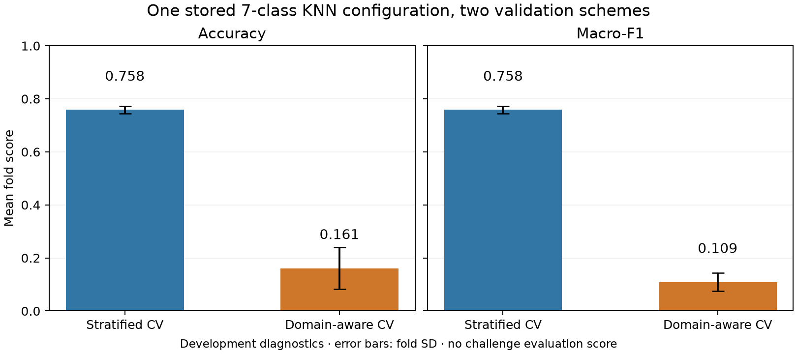
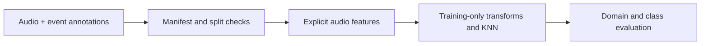

# Bioacoustic classification under domain shift

[](https://github.com/odebrino/biodcase-ml/actions/workflows/ci.yml)

A scientific Python project studying how validation design changes the apparent performance of a bioacoustic classifier. The maintained pipeline extracts explicit audio/spectrogram features, fits KNN with training-only preprocessing, and compares stratified and recording-domain validation.

The central finding in the stored development experiments is a large gap between familiar-distribution and unseen-domain scores for the same selected model. This makes the repository useful for examining generalization, feature design, and evaluation leakage.



| Stored 7-class configuration | Stratified CV | Domain-aware CV |
| --- | --- | --- |
| Accuracy, mean across folds | 0.7583 | 0.1612 |
| Macro-F1, mean across folds | 0.7583 | 0.1089 |

These are internal development diagnostics for one selected configuration. The model was selected by stratified CV; the domain comparison is diagnostic. [Exact artifacts, fold counts, uncertainty, and limitations](docs/RESULTS.md).

## What is implemented

- Event-manifest ingestion, label normalization, audio quality checks, and split-integrity checks.
- Waveform, spectral, time-frequency, and low-frequency feature families.
- Imputation, scaling, selection/PCA, and KNN inside a training-fitted scikit-learn pipeline.
- Train-only search with stratified and domain-aware validation, per-class/domain reports, and nearest-neighbor diagnostics.
- A data-free synthetic example and automated CPU checks.



The maintained estimator is KNN. Torch supplies audio/tensor operations; the historical CNN implementation is kept under `legacy/cnn/`.

## Run a complete example on CPU

Use Python 3.12 or 3.14 on Linux and run from the repository root:

```bash
git clone https://github.com/odebrino/biodcase-ml.git
cd biodcase-ml
python3 -m venv .venv
source .venv/bin/activate
python -m pip install -r requirements-cpu.txt -r requirements-dev.txt
python -m examples.synthetic_demo --output-dir outputs/demo
```

No GPU or external dataset is needed. The command generates short sine waves, runs the real features → KNN → evaluation path, and writes:

- `outputs/demo/summary.json`: seed, package versions, audio hashes, and synthetic metrics.
- `outputs/demo/reports/`: predictions, per-class/domain metrics, confusion plots, and fitted pipeline.
- `outputs/demo/outputs/reports/quality/`: split checks.

The labels are placeholders. These generated signals demonstrate software execution; real-data results are documented separately.

## Tests and environments

```bash
python -m pytest -q                    # maintained and historical compatibility checks
python -m pytest -q -m 'not legacy'    # maintained workflow
python -m pytest -q -m legacy          # historical CNN/cache checks
```

CPU dependency versions are pinned in `requirements-cpu.txt`, `requirements.txt`, and `requirements-dev.txt`. Torchaudio is optional; the CPU example and tests support the SciPy audio fallback. CI checks the maintained workflow and example on Python 3.12/3.14 and historical compatibility separately on 3.14.

For GPU experiments, install a mutually compatible Torch/torchvision/audio stack using the [official PyTorch selector](https://pytorch.org/get-started/locally/) and rerun the tests. `requirements-cu124.txt` records an older CUDA route and is not the current CPU environment.

## Real data and scientific scope

The repository classifies **already annotated events**. The official BioDCASE task also requires temporal detection/localization, so these classification metrics are not challenge leaderboard results.

The source development set has `train` and `validation`; this project holds `validation` out from fitting and selection. A separate official challenge evaluation set exists. Legacy output names such as `official_test_metrics.json` refer to the configured holdout in this codebase.

The 76,123-row processed manifest is included; raw WAVs must be obtained separately. [Download, attribution, layout, and report-generation instructions](docs/DATA_ACCESS.md). [Detailed dataset specification](DATASET_SPEC.md).

## Contributions and reuse

Maintained by [Rafael Ode Brino](https://github.com/odebrino). The documented release work includes the CPU environment, synthetic example, CI, baseline correction, portable report generation, and result-provenance review. [Contribution evidence and scientific scope](docs/CONTRIBUTIONS.md).

Original code is available under the [MIT license](LICENSE). Dataset-derived materials and third-party assets retain their original terms; see [NOTICE](NOTICE) and [data attribution](docs/DATA_ACCESS.md).

## Evidence and project context

[Results and artifact inventory](docs/RESULTS.md) · [Experiment history](docs/EXPERIMENT_HISTORY.md) · [Annotation/label background](ANNOTATION_GUIDELINES_SUMMARY.md)

Source recordings and annotations are credited to the external BioDCASE/ATBFL contributors through the linked dataset record. Original study results and later reproducibility changes are distinguished in the linked evidence documents.
